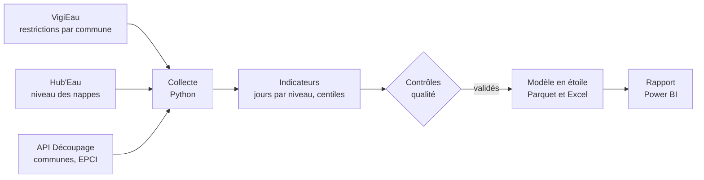
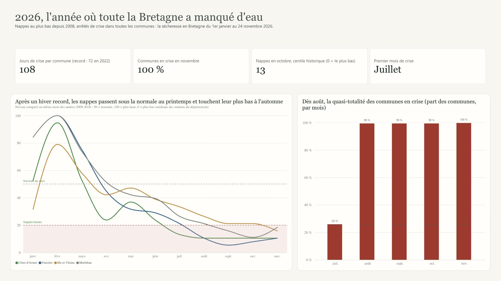
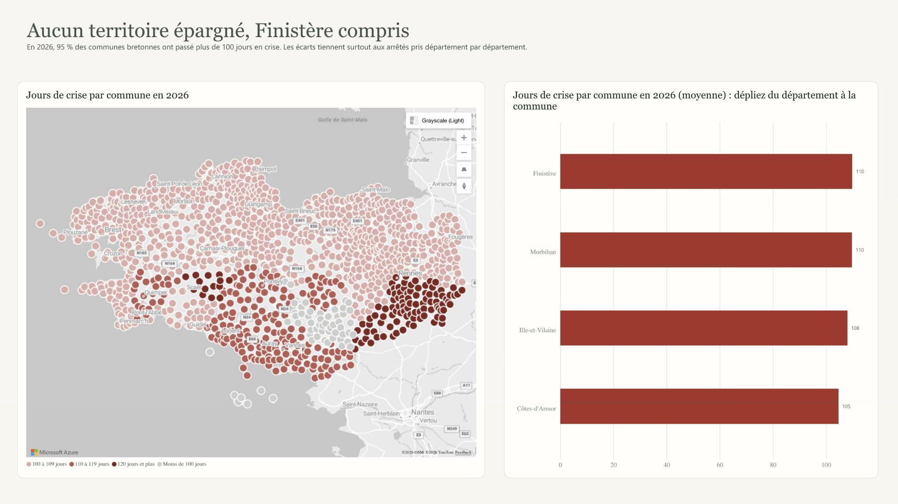
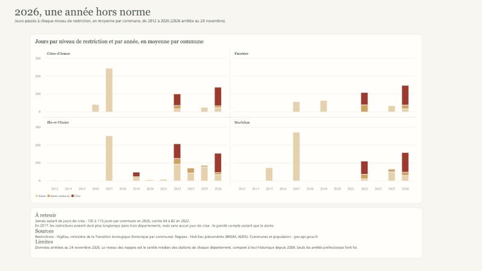

# Sécheresse 2026 en Bretagne

**En 2026, la Bretagne a-t-elle connu une sécheresse hors norme, et comment s'est-elle propagée des nappes aux arrêtés de restriction ?**

Ce projet croise deux sources ouvertes : l'historique communal des restrictions d'eau (VigiEau) et le niveau des nappes phréatiques (Hub'Eau). Un pipeline Python les prépare en modèle en étoile, puis un rapport Power BI de trois pages en tire les résultats.

| Pour aller plus loin | |
|---|---|
| [**Rapport Power BI en ligne**](https://app.powerbi.com/view?r=eyJrIjoiNWNlMWZkZmUtYmU3Mi00ZGM0LWE5YWQtZTVhZjc0ZGZkYWYyIiwidCI6IjZmMWFkZjIyLTgwOGEtNDIxZC04MTk1LWVjZmI1NTQyMTBmNSJ9) | Trois pages interactives, sans compte |
| [Méthodologie](docs/METHODOLOGIE.md) | Sources, traitements, indicateurs, contrôles et limites |
| [Mesures DAX](powerbi/mesures.dax) | Toutes les mesures du modèle |
| [Fichier Power BI](powerbi/secheresse_bretagne_2026.pbix) | Le rapport à ouvrir dans Power BI Desktop |

> Données arrêtées au **24 novembre 2026**. L'année n'est pas terminée : les chiffres de 2026 ne peuvent qu'augmenter.

## En bref

- **108 jours de crise** en moyenne par commune en 2026, contre 72 en 2022, l'ancien record. Aucune année depuis 2012 n'en approche.
- **95 % des communes** dépassent 100 jours de crise. Les quatre départements sont touchés de la même façon : de 105 jours (Côtes-d'Armor) à 110 (Finistère, Morbihan).
- Le premier arrêté de crise tombe en **juillet** (26 % des communes). Dès **août**, 99 % des communes sont en crise, et toutes le sont en novembre.
- Les nappes passent d'un **niveau record en février** à leur plus bas pour la saison à l'automne : **13e centile** en octobre en moyenne régionale.

## La méthode



1. **Collecter.** L'historique national VigiEau (près de 12 Go décompressés) est lu en flux et seules les communes bretonnes sont conservées. Les chroniques des stations piézométriques des quatre départements viennent de Hub'Eau.
2. **Calculer.** Chaque jour, une commune prend le niveau le plus sévère parmi ses ressources (eau potable, eaux souterraines, eaux de surface). Les jours sont comptés par niveau et par mois. Chaque mois de nappe est situé par rapport aux mêmes mois de sa station depuis 2008.
3. **Contrôler.** Six contrôles bloquants empêchent de publier des tables incohérentes : clés uniques, communes connues, mois du calendrier, jours compatibles avec le mois, centiles entre 0 et 100, coordonnées présentes.
4. **Restituer.** Le modèle Power BI lit le classeur Excel publié dans ce dépôt. Tous les indicateurs sont des moyennes par commune.

## Le rapport

### 1. De la nappe à l'arrêté



Après un hiver très arrosé, les nappes sont au plus haut en février dans les quatre départements. Elles passent sous la normale au printemps, sous le seuil de nappes basses (20e centile) en été, et y restent jusqu'en novembre. Les arrêtés suivent avec un temps de retard : la crise démarre en juillet et couvre presque toute la région dès août.

### 2. Les territoires



Aucun département n'est épargné, Finistère compris, pourtant réputé plus arrosé. Les écarts entre communes suivent surtout les limites départementales, car ce sont les préfectures qui prennent les arrêtés. Le graphique de droite se déplie du département à l'intercommunalité puis à la commune.

### 3. Année par année



2017 reste l'année la plus longue, avec 207 jours de restriction par commune, mais sans aucun jour de crise. 2022 avait installé la crise pour la première fois à grande échelle. 2026 combine la durée et la gravité : 147 jours de restriction, dont 108 de crise.

### Les chiffres par année

| Année | Jours de restriction par commune | dont jours de crise |
|---|---|---|
| 2017 | 207 | 0 |
| 2019 | 27 | 7 |
| 2022 | 132 | 72 |
| 2023 | 19 | 0 |
| 2025 | 50 | 1 |
| **2026** (au 24 novembre) | **147** | **108** |

Les années non citées comptent moins de 15 jours de restriction par commune.

## Fichiers produits

| Fichier | Contenu |
|---|---|
| [`secheresse_bretagne_2026.pbix`](powerbi/secheresse_bretagne_2026.pbix) | Le rapport Power BI complet, modèle et données compris |
| [`secheresse_bretagne.xlsx`](powerbi/donnees/secheresse_bretagne.xlsx) | Les cinq tables du modèle, une feuille chacune : source du rapport Power BI |
| [`dim_commune.parquet`](data/processed/dim_commune.parquet) | 1 202 communes : département, intercommunalité, coordonnées |
| [`dim_departement.parquet`](data/processed/dim_departement.parquet) | Les quatre départements |
| [`dim_mois.parquet`](data/processed/dim_mois.parquet) | Calendrier mensuel 2008-2026 |
| [`fact_restrictions_mois.parquet`](data/processed/fact_restrictions_mois.parquet) | Jours d'alerte, d'alerte renforcée et de crise par commune et par mois |
| [`fact_nappes_mois.parquet`](data/processed/fact_nappes_mois.parquet) | Centile médian des nappes par département et par mois |

## Reproduire

Prérequis : Python 3.12 ou plus. Les fichiers bruts (plusieurs centaines de Mo) ne sont pas versionnés ; la collecte les recrée dans `data/raw/`.

```bash
python3 -m venv .venv
.venv/bin/pip install -e '.[dev]'
.venv/bin/python -m secheresse_bretagne tout
```

| Étape | Commande | Rôle |
|---|---|---|
| `collecte` | `python -m secheresse_bretagne collecte` | Télécharge communes, nappes et restrictions dans `data/raw/` |
| `transformation` | `python -m secheresse_bretagne transformation` | Calcule les indicateurs, contrôle et écrit Parquet et Excel |
| `tout` | `python -m secheresse_bretagne tout` | Les deux étapes |

Les tests :

```bash
.venv/bin/python -m pytest
```

Pour mettre le rapport à jour, il suffit de pousser le nouveau classeur Excel sur la branche `main` puis d'actualiser le modèle sémantique dans Power BI.

## Structure

```text
src/secheresse_bretagne/   Collecte, calcul des indicateurs, contrôles, assemblage du modèle
tests/                     Tests unitaires (lecture en flux, comptage des jours, centiles)
data/processed/            Tables du modèle au format Parquet
powerbi/                   Rapport .pbix, classeur source et mesures DAX
docs/                      Méthodologie et captures du rapport
```

## Limites

- Les arrêtés traduisent une décision préfectorale, pas seulement l'état de la ressource : à sécheresse égale, deux départements peuvent réagir différemment.
- Le niveau des nappes est un centile relatif à 2008-2026 : il dit si une nappe est basse pour la saison, pas si elle est vide.
- Les jours de crise sont une moyenne par commune, sans pondération par la population.
- Seules les publications officielles des préfectures font foi pour les restrictions.

## Sources

| Source | Producteur | Licence |
|---|---|---|
| [Données sécheresse VigiEau](https://www.data.gouv.fr/datasets/donnee-secheresse-vigieau/) | Ministère de la Transition écologique | Licence Ouverte 2.0 |
| [Hub'Eau Piézométrie](https://hubeau.eaufrance.fr/page/api-piezometrie) | BRGM, ADES | Licence Ouverte 2.0 |
| [API Découpage administratif](https://geo.api.gouv.fr/decoupage-administratif) | Etalab | Licence Ouverte 2.0 |

## Licence

Code sous licence [MIT](LICENSE). Les données restent soumises à la licence de leur producteur.
